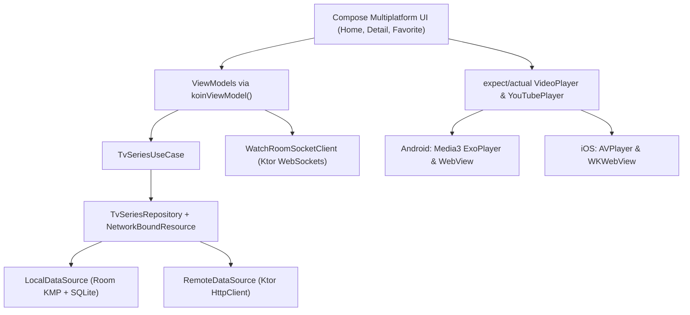

# Barnaton-CMP

Cross-platform TV series catalog, offline cache, and streaming preview application built with Kotlin Multiplatform and Compose Multiplatform targeting Android and iOS.

## Screenshots

| Home Catalog | Detail & HLS Stream | YouTube Trailer & Live Room | Favorites |
| :---: | :---: | :---: | :---: |
| *Add screenshot here (`docs/screenshots/home.png`)* | *Add screenshot here (`docs/screenshots/hls_player.png`)* | *Add screenshot here (`docs/screenshots/youtube_watch_room.png`)* | *Add screenshot here (`docs/screenshots/favorites.png`)* |

## Features

- **TMDB Catalog & Search:** Browse On Air, Popular, and Top Rated TV series and search across TMDB.
- **Offline-First Caching & Favorites:** Stores series lists and user favorites locally using Room KMP + bundled SQLite (`NetworkBoundResource` falls back to cached DB data when offline).
- **Adaptive HLS Streaming (`expect`/`actual`):** Plays HLS streams natively via `Media3 ExoPlayer` on Android and `AVPlayer` (`AVPlayerViewController`) on iOS.
- **Official YouTube Trailers (`expect`/`actual`):** Fetches `/tv/{id}/videos` from TMDB and embeds YouTube trailers via `WebView` (Android) and `WKWebView` (iOS), with a one-tap external YouTube fallback.
- **Real-Time Watch Room Counter:** Connects via `Ktor Client WebSockets` (`WatchRoomSocketClient`) on the detail screen to demonstrate bidirectional WebSocket session and lifecycle cleanup.

## Architecture & Tech Stack

The project follows Clean Architecture + MVVM with unidirectional `StateFlow` UI state inside `commonMain`, backed by Koin `koinViewModel()` scoping and thin `expect`/`actual` platform wrappers:



### Tech Stack

- **Language & UI:** Kotlin `2.3.20`, Compose Multiplatform `1.10.3` (Material 3)
- **Navigation & Lifecycle:** Navigation Compose Multiplatform `2.9.2`, Lifecycle ViewModel/Runtime Compose `2.10.0`
- **DI:** Koin `4.2.1` (`koin-core`, `koin-compose`, `koin-compose-viewmodel`, `koin-android`)
- **Networking & Realtime:** Ktor Client `3.1.3` (`okhttp` on Android, `darwin` on iOS, `websockets`, `content-negotiation`) + `kotlinx-serialization-json` `1.11.0`
- **Persistence:** Room KMP `2.8.4` + `sqlite-bundled` `2.6.2` + KSP `2.3.6`
- **Media & Images:** AndroidX Media3 `1.3.1` (`ExoPlayer` + HLS), Apple `AVFoundation`/`AVKit`/`WebKit`, Coil `3.1.0` (`coil-compose`, `coil-network-ktor3`)

## Project Structure

```text
Barnaton-CMP/
├── composeApp/
│   ├── build.gradle.kts
│   └── src/
│       ├── commonMain/kotlin/
│       │   ├── App.kt
│       │   ├── data/            # NetworkBoundResource, Repository, Room DAOs/Entities, Ktor RemoteDataSource & WatchRoomSocketClient
│       │   ├── di/              # Shared Koin modules & platform expect module
│       │   ├── domain/          # Domain models (TvSeries, TvVideo, WatchRoomState) & UseCases
│       │   ├── ui/              # Screens, ViewModels, shared Compose UI components & expect players
│       │   └── utils/           # DataMapper, NetworkError, Result
│       ├── androidMain/         # MainActivity, TvSeriesApplication, Room builder, Media3 VideoPlayer & WebView YouTubePlayer
│       └── iosMain/             # MainViewController, Room builder, AVPlayer VideoPlayer & WKWebView YouTubePlayer
├── gradle/
│   └── libs.versions.toml
├── iosApp/
│   ├── Configuration/Config.xcconfig
│   └── iosApp/                  # SwiftUI entry point, ContentView & Info.plist
└── local.properties.example
```

## Prerequisites

- **JDK:** 17–21 (verified with Android Studio JBR 21)
- **Android Studio:** Meerkat / Narwhal or newer with Android SDK `compileSdk 36` (`minSdk 24`), AGP `8.11.2`
- **macOS & Xcode (iOS only):** Xcode 15+ (`iOS 15.3+`, `arm64`). No CocoaPods or Swift Package Manager setup is required; the Xcode build phase directly executes `./gradlew :composeApp:embedAndSignAppleFrameworkForXcode`.

## Configuration

TMDB API keys are read at build time from `local.properties` (gitignored) or the `TMDB_API_KEY` environment variable and generated into `utils.AppConfig`.

1. Copy the template file in the repository root:
   ```bash
   cp local.properties.example local.properties
   ```
   *(Windows PowerShell: `Copy-Item local.properties.example local.properties`)*
2. Set your TMDB v3 API key (and `sdk.dir` if running Gradle outside Android Studio) in `local.properties`:
   ```properties
   sdk.dir=/path/to/Android/Sdk
   TMDB_API_KEY=your_tmdb_api_key_here
   ```
3. *(iOS physical device only)* Fill in `TEAM_ID` inside `iosApp/Configuration/Config.xcconfig` for code signing.

## Build and Run

### Android

- Build the debug APK:
  ```bash
  ./gradlew :composeApp:assembleDebug
  ```
  *(Windows PowerShell: `.\gradlew.bat :composeApp:assembleDebug`)*
- Or open the repository in Android Studio and run the `composeApp` configuration on an emulator or device.

### iOS (macOS)

1. Ensure Gradle prerequisites (`local.properties`) are configured so Gradle can generate `AppConfig`.
2. Open `iosApp/iosApp.xcodeproj` in Xcode.
3. Select an iOS Simulator or connected device and click **Run**.

## Technical Trade-offs

- **Media3 `TextureView` + Emulator Decoder Bypass:** `PlayerView` defaults to `SurfaceView`, which can clip or tear inside Compose scrolling containers, and Android's x86_64 emulator `c2.goldfish.h264.decoder` distorts H.264 YUV stride into tiled scanlines. Inflating `view_video_player.xml` (`surface_type="texture_view"`) and filtering out `goldfish` codecs strictly on emulators keeps hardware acceleration untouched on physical devices.
- **`WebView` / `WKWebView` for YouTube Trailers:** TMDB `/tv/{id}/videos` provides YouTube keys rather than raw `.mp4`/`.m3u8` URLs. Rendering YouTube embeds inside platform WebViews avoids third-party native wrapper dependencies across Android and iOS, paired with an external YouTube button when a channel restricts embedded playback.
- **Offline-First Cache Fallback (`NetworkBoundResource`):** Cached catalog data is emitted immediately and retained when network requests fail, while search queries disable stale cache emission so previous search results never bleed into a new query.
- **Public WebSocket Echo Endpoint:** `WatchRoomSocketClient` connects to `wss://ws.postman-echo.com/raw` to demonstrate live Ktor WebSocket framing, periodic heartbeats, and `DisposableEffect` + `ViewModel.onCleared()` session cancellation without requiring a separate backend deployment.
- **Direct Gradle Apple Framework Integration:** `iosApp` builds `ComposeApp.framework` directly via Xcode's Gradle script phase rather than adding CocoaPods or SPM overhead for a zero-pod iOS target.
